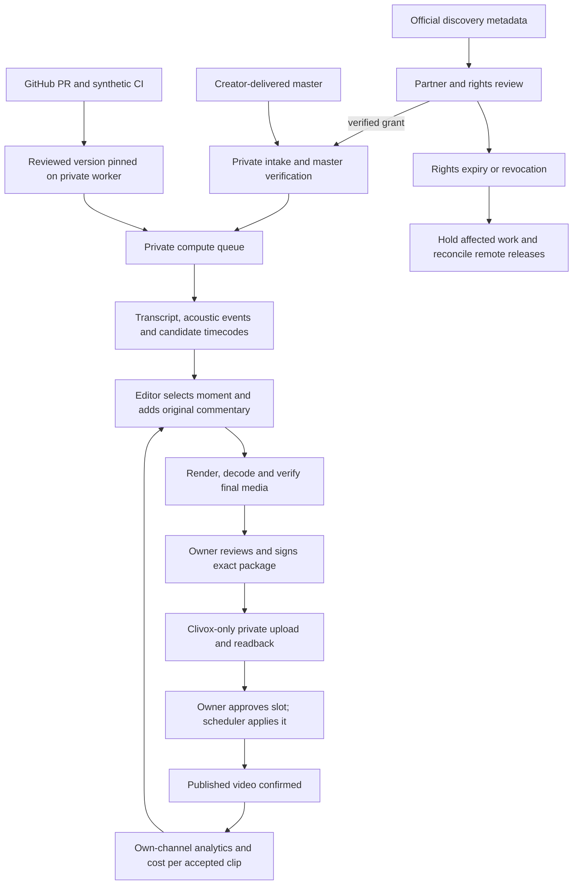

# Clivox clipping automation architecture

**Design for one creator, one private CPU worker and one YouTube channel.** A creator delivers a licensed master once. The system inspects it, proposes moments, prepares an editorial review, renders the approved edit, checks the final file, and carries out each authorized release step. The editor spends time on context and original commentary. The owner sees the exact video, metadata and channel before authorizing release.

This is the deployment design for Branch 3. GitHub currently runs the synthetic benchmark. The last recorded production handoff still requires a verified creator grant, approved private media storage, owner signing and Clivox-specific OAuth. The local speech benchmark turned 64.75 seconds of generated narration into two captioned previews. It establishes that the media path runs. A licensed episode is needed to measure editorial quality and cost. [Benchmark and inventory](README.md) · [Existing production handoff](../REAL_PRODUCTION_ACTIVATION_OWNER_HANDOFF.md)

## Deployment

| Component | Responsibility and deployment |
| --- | --- |
| GitHub controller | Keep code, schemas, pinned model/tool versions, synthetic fixtures and redacted CI results in the existing public Branch 3 repository. A passing PR validates the software. An approved deployment pins the reviewed commit on the private worker. PR code has no path to its credentials. Hosted Actions are used for software testing. [GitHub Actions terms](https://docs.github.com/en/site-policy/github-terms/github-terms-for-additional-products-and-features) |
| Private worker | Start with one owner-controlled machine running Python, faster-whisper base INT8, FFmpeg with libass, and FFprobe. Use a supervised background service and a periodic intake scan that catches missed delivery events after a restart. Process one master at a time. Private content stays in the approved encrypted storage boundary. [faster-whisper implementation](https://github.com/SYSTRAN/faster-whisper) |
| Operational state | Use a local SQLite database for repeatable compute jobs and completion events. Keep masters, proxies, captions and renders in encrypted storage under immutable object versions with a digest. Store leases and job identifiers in the database. Backup with a consistent database snapshot and a matching manifest of object versions. A single host fits SQLite WAL's same-host constraint. [Compute schema](compute_queue.sql) · [SQLite WAL](https://www.sqlite.org/wal.html) |
| Review and release | Use a private review surface. Show source context, edits, captions and final playback. Store decisions, signer identity and exact digests privately. The protected release process alone can request a channel write. It uses the project’s A2 revocation authority, A6 owner signature, A7 channel check and A8 attempt ledger. A worker queue row conveys compute status only. [Release preflight](../P9_PRIVATE_FIRST_SOURCE_FREE_PREFLIGHT.md) |
| Analytics and finance | A separate read-only identity retrieves available Clivox metrics. A private business record tracks the service fee or campaign settlement, labour, storage and compute. Only redacted engineering summaries go to public CI. [Existing analytics setup](../../a10/OWNER_ANALYTICS_READONLY_SETUP.md) |

After activation, intake detects new deliveries and the queue drives work immediately. Review decisions wake waiting jobs. A recurring private reconciliation job checks overdue leases, release readbacks, revocations, publication status and analytics deadlines. A GitHub scheduled health check may report worker availability using aggregate status. Scheduled GitHub workflows run on the default branch and can be delayed. The private scheduler stores deadlines durably and catches up after downtime. [GitHub schedule behavior](https://docs.github.com/en/actions/reference/workflows-and-actions/events-that-trigger-workflows#schedule)

### How the upstream tests shaped the design

- **Moment selection.** OpenShorts’ overlap function kept the stronger of two overlapping excerpts in the upstream test. Apply that rule across transcript and acoustic proposals before the editor sees the shortlist. Preserve the original evidence and timecodes so the editor can recover a discarded alternative. [Pinned OpenShorts selector](https://github.com/mutonby/openshorts/blob/60e77143fabb54d9d4c7068ce9a65ef93a69be4d/clip_selection.py)
- **Rendering.** The tested upstream crop kept audio and produced a portrait clip, but its final mux retained MPEG-4 Part 2. Clivox specifies the final video codec explicitly and verifies the decoded output. The miscoshorts render test informed the additional check for actual caption pixels. [Pinned cropper](https://github.com/Anil-matcha/AI-Youtube-Shorts-Generator/blob/8c9ac3103a137e53669aeebfc2af8dbdd810c35a/shorts_generator/local/clipper.py) · [Pinned render test](https://github.com/JoaquinRuiz/miscoshorts-ai/blob/5bdeb93884d4b916f291624d924a068d3662ef62/tests/test_render.py)
- **Paid scoring.** Keep an optional scoring step between candidate generation and the editor. A future model can reorder existing candidate IDs within allowed ranges. Test it on the same held-out episodes and record editor time saved per rupee. The baseline has no external model dependency during processing and can run with cached speech weights. [AutoClip scoring backend](https://github.com/zhouxiaoka/autoclip/blob/cd8e6bed18d87a81273d48bcd165751708ac715c/backend/pipeline/step3_scoring.py) · [Local speech benchmark](README.md#what-ran)

## How a recording moves through the system

| Stage | Automated action and durable output | Decision or exception |
| --- | --- | --- |
| 1. Discover and qualify | Ingest permitted public metadata or a partner submission. Deduplicate by provider and source ID. Prepare a private rights case with the requested platforms, commercial use, permitted excerpts, attribution, dates and exclusions. | Owner chooses the partner and authorizes outreach. The verified rights holder grants scope. An unresolved music, guest or game right can exclude a time range or the entire source. [Partner intake](../P2_CREATOR_PROSPECT_INTAKE.md) |
| 2. Receive master | Accept a completion manifest from the creator delivery location. Check it against the active grant and approved storage location. Verify stable byte length and SHA-256, container/streams, duration and decode. Generate a low-resolution proxy and timebase map. The original file remains immutable. | Incomplete delivery waits. A mismatch goes to quarantine. A repeated notification for the same authorized source version reuses its completed inspection. [Private master QA](../P4_PRIVATE_DELIVERED_MASTER_TECHNICAL_QA.md) |
| 3. Find moments | Downmix an analysis track, detect speech, transcribe word times and retain media-relative timestamps. Feed half-second audio levels and scene changes to P5. Combine bounded candidate windows with partner bookmarks and sentence-complete transcript proposals. Exclude disallowed intervals, collapse overlaps and return up to three review cards with lead-in, payoff, evidence and source context. | For interviews, favour a complete question/answer or claim/explanation. For gameplay, use visual changes and partner marks alongside sound. Silence and weak evidence may yield zero candidates. [P5 planner](../P5_LONGFORM_LOCAL_SIGNAL_CANDIDATE_PLANNER.md) · [Source comparisons](README.md#what-the-source-revealed) |
| 4. Edit | Show the source before and after each proposed moment. Build a versioned edit decision list (EDL) containing source in/out points, crop, commentary and voice asset, captions, credits, exclusions and destination. Generate a proxy preview. | Editor selects or rejects the moment, checks the quotes, and adds substantive Clivox commentary. Changes produce a new EDL version. A fully rejected shortlist returns to editorial intake or closes the episode. [P6 review bridge](../P5P6_LONGFORM_EDITORIAL_REVIEW_BRIDGE.md) · [YouTube originality policy](https://support.google.com/youtube/answer/1311392) |
| 5. Render and verify | FFmpeg produces a 1080×1920 H.264/AAC final with timed subtitles. Preserve faces, slides or game UI using an EDL-selected composition. FFprobe checks streams, format and duration. Decode frames and audio to check caption visibility, framing, levels, silence, sync and unexpected black frames. Record the input, output and metadata digests. | Failed QA returns the exact defect and timecode to the editor. The tested 720×1280 preview is the engineering baseline. Production resolution and multi-speaker framing require validation on the pilot source. [Render QA](../P7_SYNTHETIC_VERTICAL_RENDER_QA.md) |
| 6. Upload privately | On signed approval, verify the current grant, exact package digests and actual authorized channel. Reserve the release in A8, initiate a resumable upload with explicit private visibility, then read back the remote ID, channel, privacy and processing status. | Exact signed approval comes from the owner. A changed title, caption, source or render returns to review. An uncertain remote result enters reconciliation. [P8 review](../P8_SYNTHETIC_EXACT_MEDIA_UNSIGNED_OWNER_REVIEW.md) · [Google upload protocol](https://developers.google.com/youtube/data/guides/using_resumable_upload_protocol) |
| 7. Schedule and confirm | Apply a separately approved future slot to the processing-complete, verified private video. Persist the UTC instant and display local time in Asia/Kolkata. Read back the schedule, then check actual visibility and publication time after the slot. | A missed slot returns for rescheduling. Sending a past publish time can make a video public immediately. An existing remote schedule must be reconciled after revocation or cancellation. [YouTube video status and scheduling](https://developers.google.com/youtube/data/reference/rest/v3/videos) |
| 8. Learn and settle | At proposed ages of 24 hours, 72 hours and seven days, retrieve available own-channel metrics with reporting period and fetch time. Retain missing or delayed metrics as null. Record review minutes, accepted clips and confirmed receipts by episode. Produce an editorial experiment for the next batch. | A reviewer chooses changes to wording, framing or ranking. Campaign settlement and client acceptance follow their own terms. [YouTube metrics](https://developers.google.com/youtube/analytics/metrics) · [Clivox evaluation protocol](../EVALUATION_PROTOCOL.md) |

## Interfaces, retries and recovery

**Service-fee route.** If the contract authorizes delivery exclusively to the creator, branch after final QA and the agreed editorial approval. Deliver the approved package through the private client destination, record its digest and receipt, and close the job on client acceptance. Only a grant covering redistribution on Clivox can enter the channel-release path. That distinction lets the first paid editing pilot run independently of Clivox monetization.

Three events define the handoffs between people and software. A **master-delivered event** references a private object version, episode ID, expected digest and grant version. An **editor-decision event** identifies the candidate, reviewer, source interval and immutable EDL digest. An **owner-release event** references the signed manifest, destination and action. A later schedule decision additionally binds the verified remote video ID and UTC slot. Private documents and credentials travel through protected storage; event payloads carry only the references needed by the receiving role.

For each compute stage, hash a canonical representation of the input manifest, approved source scope, relevant stage parameters and tool/model revision. Enqueue the stage under its unique pair of stage and input digest. New EDL inputs change the render key while permitting reuse of an unchanged transcript within its grant. Validate current rights before private reads and before committing results. [Reference compute schema](compute_queue.sql)

1. Claim one available job in a short SQLite write transaction. Set a lease expiry, increment the generation and return it to the worker. Expired running jobs can be reclaimed with a higher generation. Use the database clock for claim, heartbeat and completion.
2. Write output to a per-attempt temporary location, validate it and seal an immutable object version. In one short transaction, mark the job done only if its generation still owns an unexpired lease, and insert its completion event. A stale worker discards its attempt. Garbage collection can reclaim unreferenced objects after the applicable retention window.
3. The dispatcher consumes completions and creates downstream work using a unique stage/input key. Mark completion delivered in the same transaction when the downstream work shares the database. For external delivery, acknowledge after the receiver has recorded the event ID. Retry transient compute failures with bounded exponential backoff and move exhausted jobs to a private review queue.
4. Keep remote publishing under the A8 global reservation and independent checkpoints. Persist the encrypted upload session reference before sending media bytes. After a timeout, ask Google for the existing session state and resume at its acknowledged byte offset. If completion or session identity is uncertain, reconcile against the private ledger and remote inventory. Only conclusive evidence can clear an ambiguous attempt. [A8 recovery matrix](../../a8/AMBIGUOUS_COMMIT_RECOVERY_MATRIX.md) · [Google resumable uploads](https://developers.google.com/youtube/data/guides/using_resumable_upload_protocol)

| Failure | Recovery outcome |
| --- | --- |
| Duplicate delivery or worker restart | Recover outstanding work; one completed result per stage/input version. Stale leases cannot replace the result. |
| Revocation while rendering or after scheduling | Invalidate affected jobs and queued releases, recheck the authoritative rights journal, quarantine derived material, and record the remote state. Route an already scheduled or published video to the owner’s cancellation or takedown procedure. Confirm changes remotely. |
| Wrong Google account, expired OAuth or unavailable quota | Hold channel writes. Reauthorize Clivox or wait for verified quota availability. Resume from the recorded attempt and recheck identity before writing. |
| Full disk, corrupt source or missing captions | Stop admitting new work when space is low. Identify affected episode and stage. Preserve its last valid checkpoint, repair or reacquire the authorized input, and rerun only the invalidated stages. |
| Recovery from backup | Restore the private job database and immutable objects to an isolated host. Validate manifest digests and externally anchored journal heads. Reconcile every open remote attempt before enabling writes. |

## Build order, cost and acceptance

| Increment | Deliverable | Acceptance evidence |
| --- | --- | --- |
| A. Reproducible engineering baseline | Existing CI, deterministic render fixture and optional CPU speech benchmark. Add the private compute queue and recovery harness first. | Duplicate delivery, crash before completion, stale worker, and replay of a completion each produce one valid downstream result. All tests use generated media. |
| B. First partner pilot | One signed grant, approved private storage and one delivered recording. Connect P4–P7, expose review cards and render an editor-selected original cut. | Verify transcript timing, compare candidate selection against the editor, play the full-resolution output on a phone and record actual review minutes. |
| C. First release | Enroll independent signing, revocation checkpoints, durable upload reservations and dedicated Clivox credentials. Demonstrate private upload and recovery, then apply the approved slot. | One signed package maps to one confirmed remote video. Inject a lost response and prove the reconciler avoids a second upload. Confirm the planned and actual publication states. |
| D. Repeatable production | Add the private intake timer, backpressure, age-matched analytics and per-episode settlement report. | Replay missed deliveries after an outage. Rehearse grant revocation. Compare revenue and cost across accepted edits before expanding capacity. |

**Pilot economics.** Start with one worker, one source in flight, up to three review cards and ₹0 in new software subscriptions. Electricity, storage, rights and labour are real costs. Each episode report records source minutes, transcription and render wall time, editor minutes, accepted clips, tool spend and settled receipts. Divide total episode cost by accepted clips. When the count is zero, report the episode loss and leave cost per accepted clip undefined.

For an illustrative 60-minute episode, suppose CPU transcription runs at 0.5 times source duration and other machine work takes 10 minutes. That consumes 40 worker-minutes per episode. Four available worker-hours fit six such episodes before downtime. If the editor has 60 minutes and spends 20 minutes per episode, editorial capacity is three episodes. Buying GPU time in that scenario leaves effective throughput at three. Measure both times on the actual licensed material before buying a GPU, hosted model or clipping subscription. Upgrade the bottleneck with the largest measured reduction in cost per accepted edit.

**Operator view.** Display the oldest job age, worker heartbeat, available storage, time spent waiting for review, held rights cases, unresolved uploads, missed slots and cost per accepted edit. On-call attention goes first to a revocation affecting a scheduled video or an uncertain upload. Review ranking changes on held-out episodes using the top-three acceptance rate and edit time. Compare published outcomes within the same channel, format and upload age. A weekly report can suggest an experiment; promotion of a new ranking version requires review of those results. [Research and cost model](README.md#pilot-and-spending-decision) · [Clivox capacity plan](../P11_SYNTHETIC_SCALE_RIGHTS_AND_CAPACITY.md)
