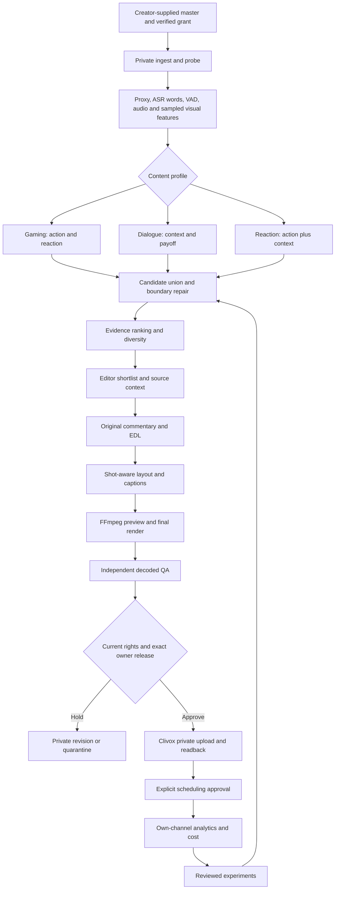

# CLIVOX V3 — multimodal clipping architecture proposal

Date: 2026-11-24 (Asia/Kolkata). Scope: Branch 3 only. Design proposal, not implementation, production authorization or a new progress claim. Preserve main, V2 A1–A10 rights/release controls, the existing 2/12 accepted V2 milestones, and FlowMinute tracks 1/2. Channel: @ClivoxPulse, UCfPEvy0SefE_5nNlYlY_CyQ.

## Decision

Build a local-first, single-private-worker pipeline with content-specific candidate detectors and a shared editorial/render/release path. Reuse the existing controller. Prefer creator-delivered authorized masters, English gaming/reaction first, then dialogue/podcast. Do not buy tooling or build SaaS/customer billing before measuring the bottleneck. Local-first describes the compute architecture, not a requirement for the owner's laptop; approved existing hardware is preferred, and a truly always-on zero-cost host is not established.

## Research evidence and limits

The November 22 [inventory](https://github.com/Tirthanand17/taskless-lab/blob/codex/clivox-clipping-research-benchmark/branch3/clipping_v2/research_20261122/inventory.json) contains 1,093 search matches and 1,041 deduplicated records from eight queries. Recount: 488 Python, 113 TypeScript, 63 JavaScript, 208 no primary language; 1,037 nonarchived, four archived; 317 MIT, 622 missing license identifier, 46 NOASSERTION. Search metadata is not a complete universe or proof of working code. Do not reuse unknown-license code. Existing [report](https://github.com/Tirthanand17/taskless-lab/blob/codex/clivox-clipping-research-benchmark/branch3/clipping_v2/research_20261122/README.md) inspected six pinned implementations, tested two upstream components, and ran a synthetic local ASR/portrait benchmark. PR #282 head 0acf8ba7a15fde49ea5ce7612512cad6baaf611d has three successful PR workflow runs (44983989905, 44983989910, 44983989907) at inspection, remains draft and unmerged. This is not a real-media test.

New inspection: seven repository trees and nine selected implementation files, plus additional public project documentation. Blob SHA below identifies inspected file contents, not a runnable upstream commit or entire audit.

| Reference | Observed method | Decision |
|---|---|---|
| [NeonClipping highlights](https://github.com/iamajmeena/neonclipping/blob/HEAD/highlights.py), blob 2225c8114ced09394137b44e76dc2022c26b8e1e | low-resolution optical flow, cut exclusion, local audio jump, frequency-band features | independently implement proxy motion/audio candidate signals; never equate screaming with payoff |
| [NeonClipping layouts](https://github.com/iamajmeena/neonclipping/blob/HEAD/layouts.py), c9a533a6dae314a7143ab64c5e88dfb2826cfc59 | deterministic geometry shared by preview and renderer | same layout data for previews and FFmpeg; game+facecam presets |
| [artbyjazi/autoclip highlights](https://github.com/artbyjazi/autoclip/blob/HEAD/backend/autoclip/pipeline/highlights.py), 52616940e2d70e71b62d35a09d0bd5d4fc86624a | 8-min transcript windows, 60s overlap, candidate refinement, second dedupe | overlapping word-index windows and evidence-bound context; tune size |
| [artbyjazi/autoclip speaker](https://github.com/artbyjazi/autoclip/blob/HEAD/backend/autoclip/pipeline/reframe/speaker.py), 2d59008c310e22154cc6cb405f24041d4b8fea3a | mouth activity correlated with diarization; ambiguous state | CPU heuristic baseline, not proof of speaker identity; fallback split/fit |
| [stream-clipper VOD scoring](https://github.com/st1fo/stream-clipper/blob/HEAD/stream_clipper/vod/scoring.py), 474b4cd753c011ffeb50c68deef24b6b35af20e6 | median/MAD normalized features, weighted fusion, nonoverlapping multi-length selection | robust local signal fusion; preserve missingness and candidate context |
| [stream-clipper spikes](https://github.com/st1fo/stream-clipper/blob/HEAD/stream_clipper/live/spikes.py), 3c29d18b8dd8a9fe40b51edab055ed4c3e8f3d47 | moving baseline, unique chatters, reaction cues | optional only when partner supplies lawfully usable synchronized chat; no third-party YouTube API-derived metrics or scraping |
| [reframe crop path](https://github.com/vxnuaj/reframe/blob/HEAD/src/reframe/path.py), 4a5719a966b93922403491e932498472ec57722e | crop keyframes, scene resets, camera smoothing | separate pure crop-path planner from renderer |
| [Auto-clipper hybrid](https://github.com/bendawg2010/Auto-clipper/blob/HEAD/analysis/hybrid_detector.py), 74e6fbf7ff57a7ca44e1375a2e0612165ca2f356 | audio/motion/scene and game-specific profiles | optional HUD/event profiles; no forced clip quota or weak fallback promotion |
| [Reelsaw layout](https://github.com/osbytes/reelsaw/blob/HEAD/apps/server/src/pipeline/layout.ts), 4b20f875ba2f3424fe6ff022e904a7c2463bed11 | per-shot decisions, group/fit fallback, smooth tracking | independently design layout; AGPL and other license obligations require review; no code copied |
| [OpenClipper](https://github.com/GrepCut/OpenClipper) | smart-crop native pipeline tree and docs | design reference; avoid desktop deployment complexity |

Previous six: zhouxiaoka/autoclip (staged ranking), Anil-matcha/AI-Youtube-Shorts-Generator (FFmpeg cut, crop), mutonby/openshorts (overlap and word boundaries), ClipsAI/clipsai (semantic segmentation), modelscope/FunClip (speaker/ASR editing), JoaquinRuiz/miscoshorts-ai (decoded output caption tests). Prior upstream executions covered only crop and overlap functions. No fresh upstream execution or head-to-head accuracy test claimed. Compare all approaches on the same holdout before selecting a production winner. Use independently authored adapters; review repository, dependency and model licenses before incorporation.

## Architecture

### Control plane and private data plane

Use one Python worker, encrypted/private filesystem and SQLite WAL for durable repeatable compute stages. Existing A2/A3 and A6–A8 remain authoritative for legal and remote-release states; no second release controller. Public GitHub contains code, synthetic fixtures, docs and CI only. No media, transcripts, contracts, personal chat, secrets or private artifacts in public Actions. GitHub Actions tests software, not routine production processing. The worker has separate read/write scopes; no upload token available to analysis/render stages. Approved private host, storage and recovery test are prerequisite. No automatic billing.

Use bounded files, network-denied decode subprocesses, pinned dependency/model checksums, time/memory limits, disk quota, atomic write to temp then rename, SHA-256 hashes, UTC timestamps and source timeline with integer milliseconds plus rational frame/timebase mapping. Preserve exact original media, account for VFR, nonzero track starts and audio offsets. Reject symlinks/path escapes and untrusted embedded URLs or prompts. Cache analysis by source SHA + stage version + configuration + model digest; remove on retention or revocation as required.

A single-worker SQLite queue: unique(stage,input_digest), ready/running/done/held, attempt count, availability, lease expiration, monotonically increasing lease generation, result digest, completion receipt. Claim and complete in transactions; stale workers cannot commit outputs; requeue expired repeatable computation with bounded backoff; quarantine persistent failures. Never auto-retry ambiguous external uploads. Keep job state separate from rights and approval. Back up private database/manifests and verify restore.

### Stage contracts

| Stage | Input → output | Acceptance |
|---|---|---|
| 0 rights & intake | verified scope + creator-delivered file → source manifest | rights current for channel/use, exact SHA, private path, validated media |
| 1 extract | source → audio proxy, word timestamps/confidences, VAD, per-second RMS/cuts/motion | consistent source timebase, bounded processing, missing features explicit |
| 2 propose | features + profile → candidate events/intervals and evidence | no fabricated words or events; retain uncertainty; no candidate is valid outcome |
| 3 refine/rank | events → deduped shortlist | event inside interval; whole utterance/action; context; evidence anchors; no platform-data-derived scores |
| 4 edit | approved candidate → versioned EDL | original CLIVOX angle; verified quote; music/game/guest scope; editor decision |
| 5 frame | EDL + shot/face tracks → layout plan/crop keyframes | preserve relevant subjects and HUD; fallback fit/split when ambiguous |
| 6 render | EDL + layout + caption/audio assets → exact MP4, SRT, metadata and hashes | H.264 yuv420p/AAC, target 1080x1920, source-appropriate FPS, no unnecessary upscaling |
| 7 verify | decoded media + EDL → QA report | independent codec, duration, frame/caption pixels, safe area, audio peak, sync, context and phone review |
| 8 release | exact media/metadata + rights + owner approval → private remote ID and receipt | correct channel, current rights, immutable intent, remote processing/restriction readback; separate scheduling approval |
| 9 learn | own approved releases → permitted official analytics + independently measured costs | same upload age and niche; missing values null; no promises of virality |

Required private schemas: SourceManifest, FeatureManifest, Candidate (source SHA, start/end ms, event anchors, feature evidence, missingness, confidence, detector version), EditSpec (quote/rights, commentary, EDL, word/caption IDs, asset hashes), CropPlan (shot intervals, layout and normalized bounded keyframes, confidence), RenderManifest, QAReport, existing exact release/attempt receipt, experiment record. All downstream hashes depend on exact upstream version; editing any approved item invalidates release. Untrusted text never instructs a worker.

### Detection strategy

First-pass full source: 16 kHz mono speech, faster-whisper base INT8 + Silero VAD; low-resolution 160x90 or 320x180 frames 2–4fps, audio relative energy, scene cuts, motion excluding hard cuts. Use original timestamps across chunks; overlap chunks; dedup events at boundaries; cap source/chunk workloads; handle silence, missing audio and no-face cases. Benchmark faster-whisper small or GPU only after measuring ASR accuracy and throughput.

Gaming: candidate union of adaptive acoustic peaks, visual motion, scene transitions as context, creator timestamps, spoken reactions; optional licensed game-specific HUD/OCR/event cues. Reject menus/loading/repetitive motion; allow quiet or nonverbal skill moments. Start with GTA/gameplay only when source actually contains gameplay, not a discussion mislabeled as footage. Reaction content combines what happened with commentary and preserves the referent. Dialogue: overlapping word-index windows, topic/change cues, complete thought, conversational question/answer, specific reveal and punchline; optional local LLM reranker only produces bounded word IDs and evidence references. Treat source as untrusted data and validate model outputs. No paid model needed for baseline.

Normalize media features by robust local baseline (median/MAD with stable-scale fallback); never insert 0 for unavailable feature; rank only applicable evidence; missing required editorial checks hold. Candidate windows initially target 20–55 s, flexible when completeness demands; use event pre/post context, VAD/sentence/shot boundaries and independent context review. Greedy overlap suppression followed by second dedupe after refinement, plus diversity by scene/topic. Avoid forcing output when no good moment. Keep three independently testable variants: acoustic, transcript/visual, combined. Candidate score is editorial priority, not predicted virality.

Proposed rubric (0–4 per feature, weights sum 100): opening 20, standalone context 20, actual payoff 20, visual/action relevance 15, original commentary potential 15, clarity 10. Human review remains separate from ranking; rights and technical QA are hard gates. Reweight by content profile only after holdout comparisons; all weights are hypotheses, not learned or calibrated probabilities.

### Editing and reframing

For gaming, creator-confirmed webcam region and gameplay region, preserve HUD/action; stack, gameplay-only, or fit; never crop solely to a face. Dialogue, single speaker crop; two speakers split or switch with confidence; crowd, slide, screen share and no-face use full-frame fit/pad. Track per shot, smooth crop path with dead zone, capped velocity and minimum dwell; reset at actual cut. Start with OpenCV face detector/tracking and optional mouth-motion/VAD baseline. If benchmark shows speaker errors, test LR-ASD/TalkNet with model-license review; never infer identity or force an ambiguous speaker crop.

Use one editable EDL for preview/final, source-relative cut, original narration/context, captions with verified word times, audio ducking and meaningful licensed effects only. Keep hook accurate; no fake quotes, voice imitation or artificial engagement. ASS/libass burn-in with safe mobile margins and accessible SRT, 1–2 short lines, caption-safe HUD/face positions. Normalize dialogue and check peak clipping, maintain sync, source-appropriate frame rate (30/60 where supported). Export H.264 AAC MP4; verify real decoded caption pixels, no clipped words/faces/HUD, unexpected black/silent sections or missing commentary. Owner watches exact file on phone. Permission alone does not establish YPP originality.

## Evaluation and pilot gates

Use 2–3 or more authorized recordings, 40–60 human-labelled moments, 20 corrected transcript excerpts, hold out whole episodes; expand to separate creator holdout before scale. Include quiet punchline, noisy background, silent skill, overlapping speakers, no faces, scene transitions, VFR/time offsets, multilingual speech, missing chat and game menus. No labels from unapproved sources. Compare same review budget, source and clip duration constraints. Measure recall of editor accepted moments, top-3/top-5 acceptance, duplicate rate, median boundary correction seconds, false positive types, WER, caption drift, speaker/HUD crop errors, editor minutes per accepted clip, worker minutes/source hour, cost per accepted clip. Report uncertainty; a small sample is not evidence of retention or earnings. Proposed engineering release thresholds to approve after baseline: 100% rights/exact release/technical invariant checks, zero known quote/context/identity errors in approved outputs, no duplicates in release, combined detector beats baseline editor time without reducing held-out acceptance. If none wins, keep simpler baseline.

CI includes synthetic timestamp, chunk seam, event-outside-interval, all-silent/no-candidate, missing-modality, overlap, corrupt file, wrong-channel, stale grant, revoked grant, stale lease, restart/recovery, duplicate release, decoded caption and layout boundary tests. Real editor review and licensing remain independent. No synthetic progress inflation.

## Incremental plan (no unnecessary infrastructure)

1. Review #282 green runs, code and scope before merging through normal branch process; retain existing controller and checkpoint. Architecture proposal approval only.
2. Implement source timeline/feature contract and private deterministic source-free fixtures; incorporate benchmark adapters without copying unreviewed upstream code.
3. Implement multimodal candidate union, gaming/dialogue profiles and boundary/dedupe tests. Measure compute and compare baseline on fixture, then on authorized source.
4. Implement per-shot crop plan, gaming geometry, safe fallback and timed caption/audio EDL. Extend existing independent QA; synthetic split/no-face tests.
5. Secure first genuine partner/source grant, approved private worker/vault and editor; benchmark 40–60 real labels, produce first three private review clips. These dependencies can proceed alongside engineering only with actual authorization.
6. Integrate with existing private-first release controller and Clivox-only OAuth. Owner exact-media approval and separate scheduling approval; remote readback. No publication until real prerequisites.
7. Review official own-channel metrics at 24h/72h/7d/14d and real acceptance/cost. Scale from one partner, only when supply, quality and economics justify; live buffering, advanced speaker ML, GPU rental, web dashboard, multilingual expansion, automatic campaign integrations and SaaS are deferred.

No new live credentials, licenses, creator outreach, source download, production upload or schedule created by this proposal. No changed V2 accepted milestones or FlowMinute files. See existing [V2 architecture](https://github.com/Tirthanand17/taskless-lab/blob/main/branch3/clipping_v2/MASTER_ARCHITECTURE.md), [evaluation protocol](https://github.com/Tirthanand17/taskless-lab/blob/main/branch3/clipping_v2/EVALUATION_PROTOCOL.md), and [production handoff](https://github.com/Tirthanand17/taskless-lab/blob/main/branch3/clipping_v2/REAL_PRODUCTION_ACTIVATION_OWNER_HANDOFF.md).
