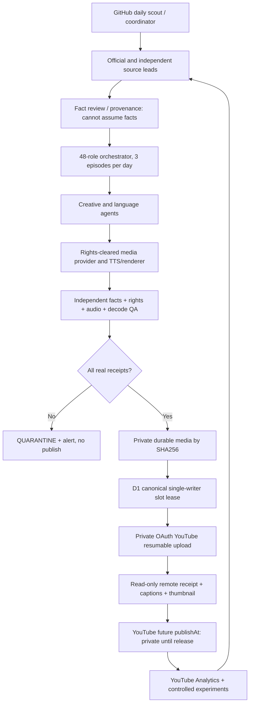

# FlowMinute Lab — GitHub-only daily cloud autopilot v1
**Research and architecture decision:** 2026-11-04 · **Status:** safe foundation staged; autonomous media generation and publishing NOT deployed.

## Two Git development tracks
- `track/assisted-youtube-releases`: preserve the existing assistant-guided, authenticated, SHA-pinned YouTube release workflow. This is not an autonomous cloud service.
- `feature/flowminute-cloud-autopilot-v1`: independent **GitHub-only** development, CI, and provider integration for future continuous 2 Shorts + 1 long per day.
- The private `flowminute-control-private/docs/FLOWMINUTE_TWO_TRACK_ROADMAP_2026-11-04.md` is the owner planning record. No access to Nirala or its storage, scheduled tasks or OAuth credentials is required or permitted by this new code.

### Daily release contract (Asia/Kolkata)
| Slot | Time | Format | Lead-time policy |
|---|---|---|---|
| morning | 11:00 | Short A | Upload early to private, verify remote processing/SRT; schedule well before publish |
| midday | 16:00 | substantive long | Original thumbnail + complete real demonstration and audio QA |
| evening | 20:30 | Short B | Distinct angle and reviewed voice from Short A |

Publish times are **targets to test**, not engagement guarantees. The cloud research planner runs the preceding evening and plans **tomorrow's** three slots. The production system should maintain 3–7 days of already QA-cleared, privately uploaded inventory to absorb provider issues and GitHub Actions scheduling delays.

## Why not simply turn on publishing?
The existing public GitHub Actions `publish-artifact-youtube.yml` needs manual `workflow_dispatch`, an approved media artifact, `PUBLISH_ENABLED=true`, `youtube-production` credentials and explicit approver receipts. The old `publish-youtube.yml` is intentionally disabled. A public flag does not supersede the private policy's `publishing_enabled=false`, which currently permits only narrow owner-approved exact-SHA releases. The cloud worker must never store Google tokens in a public GitHub branch, actions output, or research logs.

## Reuse existing agents rather than duplicate them
Existing `autopilot/agent_org.py`: deterministic orchestration of **48 specialist roles in 8 departments**, 18 evidence-constrained steps per video, up to three parallel episodes. The new `daily_cloud_plan.py` prepares three episode work contracts by using that registry; it does not falsely claim that any model has already written a script, made a thumbnail, rendered video, approved rights or uploaded to YouTube.

| Department | Independent agent duties | True handoff criterion |
|---|---|---|
| Research | launch/evergreen scout, evidence curator, viewer problem scorer | timestamped primary source + independent corroboration |
| Creative | Shorts writers, long-form writer, hook and retention editor, thumbnail strategist | demonstrable, differentiated result; factual hooks |
| Language | English/Hindi editing, subtitles, voice director | language-specific reviewed script; two Shorts with distinct reviewed voices |
| Production | storyboard, real product/demo captures, motion, TTS, audio/SFX, renderer | actual H.264/AAC master + original visuals and caption timestamps |
| Quality | independent fact/rights/privacy/audio/media reviewers | auditable source-to-claim map, real playback/listening, ffmpeg full decode, hashes |
| Publishing | calendar, lease, uploader, remote verifier, recovery and budget controller | immutable QA receipt, private processing and caption serving, exact future UTC |
| Analytics | Shorts and long-form retention/CTR/subscriber analysts | authenticated YouTube Analytics reports, measured age-aligned cohorts |
| Learning | experimentation and regression agents | one hypothesis/variable, monitored downside, no fake performance claims |

**Not an LLM yet:** the agent registry is deterministic software with permission-scoped task handoffs. A real generative model, retrieval provider or renderer is only “connected” after a separate documented provider integration and real evaluation. RSS headlines remain **unverified leads**; do not turn them into scripts or fake media.

## Provider research and tradeoffs (official docs checked 2026-11-04)

| Provider | Useful now | What it cannot guarantee |
|---|---|---|
| GitHub Actions standard hosted runners (public repo) | Unprivileged scheduled research, no-secrets Python CI, illustrative render smoke; publicly documented runner compute is included for public repos | Exact-time cron execution; unlimited media artifact storage; GPU/LLM inference; an encrypted durable release ledger |
| Cloudflare Workers Free | Lightweight HTTP/Cron coordination; previously partially deployed metadata monitoring | Three full 1080p video renders/day: Free 10 ms CPU / 128 MB memory per Worker; cannot hold multi-GB media in a Worker |
| Cloudflare D1 | Durable relational release metadata and lease coordination *after a verified schema migration and writer-fence acceptance* | Canonical production slot uniqueness/recovery currently unverified; a SQLite test isn't proof of cloud D1 transaction semantics |
| Cloudflare R2 | Candidate private object store (10 GB-month standard storage free tier) | Hard zero-billing ceiling or safe private media retention without explicit lifecycle/budget controls and approval |
| Google YouTube Data API | Private resumable video uploads, caption/thumbnail assets and future `publishAt` scheduling | Unlimited quota: 2026 granular default 100 `videos.insert`/day and 100 `search.list`/day in separate buckets; captions.insert still consumes 400 general quota units |
| Google OAuth | Owner-scoped YouTube/Analytics access with refresh tokens | External Testing refresh tokens generally expire in 7 days; unattended operation needs approved Production OAuth and secure rotation |
| YouTube Analytics API | Retention/view duration/engagement reporting with `yt-analytics.readonly` access | Analytics not visible with only YouTube Data API scopes; raw views cannot substitute for retention |

Cited references:
- https://docs.github.com/en/actions/reference/workflows-and-actions/events-that-trigger-workflows
- https://docs.github.com/en/actions/concepts/billing-and-usage
- https://developers.cloudflare.com/workers/platform/limits/
- https://developers.cloudflare.com/r2/pricing/
- https://developers.google.com/youtube/data/determine_quota_cost
- https://developers.google.com/youtube/data/reference/rest/v3/videos
- https://developers.google.com/youtube/data/reference/rest/v3/captions/insert
- https://developers.google.com/identity/protocols/oauth2
- https://developers.google.com/youtube/analytics/reference/

## Target runtime boundaries and data flow

### Durable exactly-once release state machine
`DRAFT → SOURCE_VERIFIED → SCRIPT_APPROVED → MEDIA_RENDERED → QA_VERIFIED → UPLOAD_RESERVED → UPLOAD_UNRESOLVED → PRIVATE_UPLOADED → PROCESSING_VERIFIED → ASSETS_VERIFIED → SCHEDULE_UNRESOLVED → SCHEDULED_VERIFIED → PUBLIC_VERIFIED`.
Any ambiguous remote request stays `UNRESOLVED`: **read YouTube before retry**. Never schedule to a past time, which YouTube would publish immediately. Episode key `(channel_id, release_date_IST, slot_IST)` unique in canonical D1 and immutable media SHA. D1 must have live validated backup/restore, unique indexes and confirmed writer leases *before* production mutations. Observe cross-worker routes for rogue writers and protect private OAuth from logs and PR code.

### Security, rights, costs and editorial acceptance
- Public GitHub hosted runner: `contents: read`, no OAuth, no write, no self-hosted Nirala runner, no personal information, no chat history, no unreviewed private media artifact.
- Privileged future publisher: a **separate private compute boundary** with narrowly scoped secrets, owner approval, per-release admission, 0 accidental expense and full remote readback.
- Human full listening review remains an editorial expectation unless an alternative auditable approval/evaluation policy is explicitly accepted by the owner. Automatic decode/audio loudness tests **do not** assert expressive performance or rights.
- Prevent spam and misleading content: unique topics, real source links, truthful demos, no fake screenshots or recycled long-form filler; a missed slot is safer than a bad or duplicate upload.
- At zero verified compute and storage funding, **do not promise** three fully original high-quality HD videos daily. Benchmark on approved true providers and disclose throughput limits.

## Implementation milestone record
1. **B0 research & architecture — this document** (GitHub only).
2. **B1 three-slot planning engine — `autopilot/daily_cloud_plan.py` + no-network tests**; reuses real role registry and returns only research/agent drafts, not claims of verified content.
3. **B2 GitHub Actions scheduled scout and planning** — fix existing scout's missing ffmpeg / cryptography dependencies, review a no-write workflow and merge to main after CI. GitHub schedules do not trigger from feature branches.
4. **B3 fully generative multi-agent pipeline** — needs chosen/authorized provider for source retrieval, factual review, TTS, visuals and HD cloud rendering, plus measured runtime. No model endpoint or GPU is currently connected.
5. **B4 production migration and publisher** — requires private OAuth, durable media, D1 schema/backup/writer fencing and an owner-approved private upload pilot; keep globally disabled beforehand.
6. **B5 laptop-off seven-day acceptance** — 21 unique, verified YouTube releases, 3–7-day buffer, no duplicate or unexplained public videos, provider failure drills, no charge over approved cap.
7. **B6 feedback loop** — authenticated Analytics snapshots at 24h/72h/7d; controlled title/hook experiments based on retention, not guesses.

## Current deploy and completion semantics
The proposed GitHub Actions code on this feature branch is a *safe nonpublishing cloud foundation*. Mark `tested` only after real GitHub CI results; mark `deployed` only after merging its scheduled workflow to the default branch and verifying an actual successful scheduled execution. Do not call the daily autonomous YouTube publisher deployed until all B3–B5 gates are accepted.

### 2026 provider deprecation finding — do NOT use GitHub Models as the LLM backend
GitHub announced that **GitHub Models inference API, playground, catalog and BYOK endpoints were fully retired on July 30, 2026**: https://github.blog/changelog/2026-07-01-github-models-is-being-fully-retired-on-july-30-2026/ . Old 2025 tutorials about using `GITHUB_TOKEN` and `models: read` for GitHub Models are obsolete. `actions/ai-inference` now documents Copilot CLI with separately configured `COPILOT_GITHUB_TOKEN`; this is **not** a no-cost, approval-free daily script/video solution: https://github.com/actions/ai-inference . Do not silently install/pay for Copilot, Microsoft Foundry or another provider. B3 must evaluate a currently available, explicitly owner-approved inference route, or test a self-hosted open-weight CPU model on GitHub public-runner limitations, including accuracy and rights. Research and deterministic planning may operate without an LLM; **writing/media do not become real** just because the coordinator has role names.
