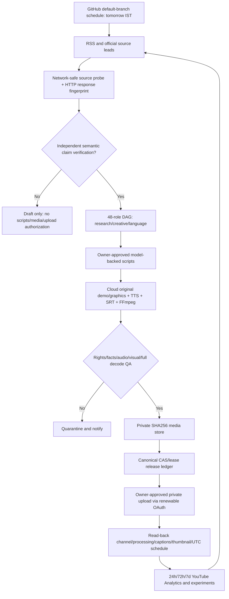

# ADR-0007 — FlowMinute cloud-only agent pipeline: source evidence before generative media
**Date:** 2026-11-04 · **Branch:** `feature/flowminute-cloud-autopilot-v1` · **Status:** Accepted for unprivileged GitHub CI only; production capabilities deferred.

## Problem and invariants
Deliver two distinct, original YouTube Shorts and one substantive long video every day at **11:00, 16:00 and 20:30 Asia/Kolkata**, without any user laptop, private local files, or ChatGPT session. Existing 48-specialist / 8-department DAG and tomorrow-plan run are proven on standard GitHub-hosted Ubuntu runners; no real LLM/TTS/render/YouTube publisher is connected. Do **not** conflate a role label with a working model agent.

The existing ChatGPT-assisted Branch 1 continues separately. Branch 2 must not inherit its Windows OAuth tokens, laptop-mounted MP4s, old release ledger, scope approvals or assumptions that an expired slot can be scheduled without unintended immediate publication.

## What the current provider docs actually support (checked 2026-11-04)
| Candidate | Verified benefits | Constraints and architectural decision |
|---|---|---|
| **GitHub Actions public standard hosted runner** | GitHub docs say standard hosted runners in public repositories have free Actions execution; CI, network research, Python, CPU-only model/TTS trials and FFmpeg feasible | Daily schedule can be late/dropped; keep a 3–7-day private finished-video buffer. No guarantee of infinite compute, free LLM inference, durable private cloud media or exact publish timing. **Selected first-stage stateless coordinator and candidate renderer.** |
| **Cloudflare Workers Free** | Cron/HTTP light coordinator; 100,000 requests/day | 10ms CPU per invocation, 128MB memory; unsuitable for sustained H.264 encoding. **Never render full MP4 here.** |
| **Cloudflare D1 Free** | 5 million rows read/day, 100K writes/day, 5GB account storage; single DB inherently serializes queries | D1 free query caps now enforced (Sept 2026). Live uniqueness/CAS, writer fencing, backups and migration **not verified**, cannot claim production release ledger. **Candidate later, no migration yet.** |
| **Cloudflare R2** | Standard storage first 10 GB-month free including limited operations, S3-compatible and zero egress fees | Requires R2 subscription checkout, operations/storage exceeding included usage are billable. No guaranteed zero-spend hard stop. **Candidate only; no activation without approval.** |
| **Google Gemini API** | Free tier for certain models; supports structured JSON output and per-project rate-limit visibility | Free-tier eligibility is model/account-dependent, limited and input may be used to improve services. Cannot supply a secret/key or safely run unlimited 3/day scripts without owner opt-in. **Candidate B3 script provider behind disabled adapter, not a deployed agent.** |
| **GitHub Models** | — | Retired July 30, 2026. **Reject obsolete GH_TOKEN `models:read` recipes**. |
| **Kokoro-82M / ONNX (Apache 2.0)** | CPU-capable localizable original voice, model rights published under Apache-2.0; GH-hosted runner can trial ONNX downloads | No model or voice weights stored in public Git; must pin exact upstream SHA, check third-party phonemizer/voices licenses, test English and Hindi quality & runtime before deployment. **Candidate B3b.** |
| **YouTube Data API 2026** | Granular quota buckets: default 100 video uploads per day; captions.insert costs 400 from shared other-unit bucket. Private video and future publishAt supported | Real OAuth consent and refresh tokens, owned correct channel, cloud secret storage, private processing, caption serving and read-only reconciliation required. **No YouTube writes until B4 owner approval.** |

References (official):
- https://docs.github.com/en/actions/concepts/billing-and-usage
- https://docs.github.com/en/actions/reference/workflows-and-actions/events-that-trigger-workflows
- https://developers.cloudflare.com/workers/platform/limits/
- https://developers.cloudflare.com/d1/platform/pricing/
- https://developers.cloudflare.com/changelog/post/2026-09-01-d1-free-tier-limit-enforcement/
- https://developers.cloudflare.com/r2/get-started/
- https://developers.cloudflare.com/r2/pricing/
- https://ai.google.dev/gemini-api/docs/pricing
- https://ai.google.dev/gemini-api/docs/rate-limits
- https://ai.google.dev/gemini-api/docs/structured-output
- https://github.blog/changelog/2026-07-30-github-models-is-now-retired/
- https://huggingface.co/hexgrad/Kokoro-82M
- https://developers.google.com/youtube/v3/getting-started
- https://developers.google.com/youtube/data/reference/rest/v3/videos/insert

## Decision: staged distributed pipeline, no fabricated automation

**Critical distinction:** HTTP 200 + digest proves page bytes were fetched, **not** that they corroborate a claim. Two independent publishers must contain independently established claim-level support. LLM summarization alone is not independent verification. The review system must record each claim, source spans, reviewer identity/tool, factual risk and unsupported/contradicted/uncertain disposition. Unreviewed RSS headlines remain `unverified_lead`.

## B3a implementation ordered steps
1. **Source evidence probing — this change.** Bounded public URL allowlist; block non-HTTPS/credentials/redirect-to-private-host; SHA256 digest and observation timestamp; public metadata only (not copyrighted full article). Integrate into scheduled GitHub research workflow with all publication flags false. Unit mock HTTP; live safe run on GitHub. Call it `SOURCE_FETCHED_NOT_FACT_CHECKED`, never `verified`.
2. **Claim ledger (next).** Allow independent claim-level corroboration records with source URI/hash, bibliographic date and excerpt *offsets*, contradiction flags; do not promote without two genuinely independent verified attestations. Build injection tests.
3. **Real model writer adapter (next).** Optional owner-approved Gemini (or independently benchmarked alternative) with strict JSON schema and source-bounded prompts; never include OAuth, personal data or any source instructions as trusted system text. Proposals require separate factual review, safe max tokens, cost cap and timeout. With absent owner-provided credentials the adapter must refuse to call external services.
4. **Quality-gated script generation.** Distinct two Shorts and informative long with useful demonstrations, original hook, captions/sounds staging plan and the exact evidence IDs. Model does not grant rights, publishing permission or `fact_reviewed`.
5. **B3b media feasibility benchmark.** Original sample 1080x1920 and 1920x1080 FFmpeg, full decode and loudness; CPU Kokoro ONNX external weights pinned, no paid services. Measure throughput and reproducibility on GitHub runners; do not claim proven 3/day until observed.
6. **B4+B5 private release system and acceptance.** Separate secret/media/D1/OAuth owner approvals, one private video pilot, seven days / 21 original releases with all client laptops powered off.

## Data contracts
**Source lead:** `publisher,title,url,published_utc,status=unverified_lead` (external and untrusted).  
**HTTP evidence:** `source_url,observed_final_url,observed_at_utc,raw_sha256,content_type,bytes_fetched,http_state`; no article body, no semantic fact review, zero release authority.  
**Claim review:** separate future `claim_id, assertion, 2+ independent supporting evidence spans, reviewer, disposition, human/model provenance` (not derived from HTTP status).  
**Media:** private object store `sha256,episode_id,release_slot,rights/facts/QA receipts`.  
**Schedule:** immutable `channel_id + local_date + slot`; preflight future UTC; ambiguous remote request → `UNRESOLVED`, no blind retry.

## Security and acceptance
- GitHub public job `contents:read`, no long-lived secrets, no OAuth, no cloud billing, no write, no user laptop. No arbitrary untrusted URL fetch; no cross-origin redirect; caps bytes/time/URLs; snippets not logged.
- No public GitHub artifact of copyrighted full pages, personal data, private video, service tokens or final media.
- Require green **existing** daily planner tests + new evidence-probe tests; run real GitHub-hosted fetch and prove reports explicitly not fact checked. A successful push event does not prove a recurring schedule event; observe actual daily schedule separately.
- Release remains off until separate owner-backed approvals for model provider and prompts, storage spend, OAuth, D1 schema and publishing.

**Current status:** B0 research/architecture refined; B1/B2 previous code operational; B3a HTTP metadata evidence implementation in progress; B3b/B4/B5 **not proven**, no customer/user charges authorized.
