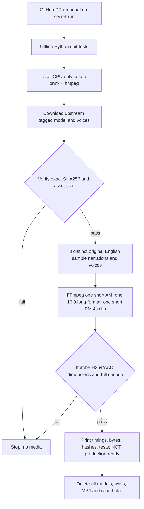

# ADR-0008 — GitHub CPU-runner Kokoro/FFmpeg feasibility before cloud media deployment

**Status:** experimental B3b benchmark, NOT autonomous production. **Date:** November 4, 2026.

## Decision
The next independently verifiable step is to synthesize **actual offline English neural narration** on GitHub-hosted public Ubuntu runners using Kokoro ONNX, then render and full-decode three short **diagnostic** clips. Two are 1080×1920 and one 1920×1080; all are H.264/AAC and contain original static/dynamic graphics. They are **not** real finished Shorts or a finished long video. They are never uploaded to YouTube or stored as GitHub artifacts. All temporary model/media bytes are destroyed when the job ends.

This probes a missing capability: the earlier `flowminute-cloud-render-smoke.yml` used *previously published audio*. Passing FFmpeg alone did not demonstrate the daily generation of fresh speech. Branch 1's Nirala files, cached voices and private OAuth keys are explicitly excluded.

## Real provider research and selected voice source
- `kokoro-onnx==0.6.1` (MIT code; Kokoro model Apache-2.0) supports CPU inference with `Kokoro(model,voices).create(text,voice=...,lang="en-us")`. Source: https://pypi.org/project/kokoro-onnx/ and https://github.com/thewh1teagle/kokoro-onnx/blob/main/examples/save.py
- Model **`kokoro-v1.0.int8.onnx`** at upstream tagged `model-files-v1.1`, exact SHA-256 `ae315a79b623f244700e4afb9246c46a26066782e049ba174bf3ba433970ee9c` (114,119,327 bytes).
- Voices **`voices-v1.0.bin`**, SHA-256 `bca610b8308e8d99f32e6fe4197e7ec01679264efed0cac9140fe9c29f1fbf7d` (28,214,398 bytes).
- Both checksums are supplied in the upstream official GitHub release API: https://github.com/thewh1teagle/kokoro-onnx/releases/tag/model-files-v1.1 . This exact release and byte-for-byte verification is more robust than `latest` or a mutable model repository branch.
- FFmpeg's `loudnorm` implements EBU R128 targeting and `ffprobe` exposes codec/pixel-format/duration; full `ffmpeg -xerror -f null -` decode catches invalid media. Official documentation: https://ffmpeg.org/ffmpeg-filters.html and https://ffmpeg.org/ffprobe.html .
- GitHub Actions publicly documents standard hosted runners free on public repositories: https://docs.github.com/en/actions/concepts/billing-and-usage . **Free standard runner time is not guaranteed unlimited scheduling, persistent media storage, safe cloud credentials, or indefinite cost-free capacity.** Thus this diagnostic runs only for PRs or explicit workflow dispatch and has a 24-minute timeout.

## Cloud design

Required dimensions and voice mappings:
| Slot | Canvas | Voice | Proof |
|---|---|---|---|
| 11:00 IST short AM | 1080 × 1920, 24 fps | `af_heart` | distinct speech + AAC and full decode |
| 16:00 IST long | 1920 × 1080, 24 fps | `am_michael` | different voice + correct horizontal format (only ~4 seconds) |
| 20:30 IST short PM | 1080 × 1920, 24 fps | `bf_emma` | third voice + unique SHA and full decode |

## Hard acceptance and non-claims
- All three separate text-to-speech calls use real offline Kokoro CPU inference on the GitHub runner, not synthetic tones or reuse of already published media.
- The Python smoke checks SHA files before import/load; refuses missing, symlinked, oversized or unexpected assets, unsafe FFmpeg output, absent AAC/H264 or incorrect format.
- Real voice files, WAVs and MP4s remain ephemeral in `/tmp`; SHA hashes and numeric metrics can appear in public job summaries, **not** copyrighted narration audio or model weights.
- The clips intentionally contain "NO PUBLISH" and fail all real `MediaQA` and editorial gates: duration too short, not a complete viewer demonstration, no independent fact verification, no creative review, no subtitles/caption synchronization or verified rights release. This is **technical feasibility only**, not a fully AI-created video.
- Do not auto-run large download on every daily 18:47 planning cycle; only changed PR or manual no-publish workflow. Repeated attempts must be rate limited.
- Do not migrate D1, activate R2 subscription, connect OAuth or touch YouTube from this workflow.

## Next acceptance sequence
1. Pass GitHub CI with actual upstream downloads and one full end-to-end TTS+three-clip render; measure wall time/CPU and size, investigate failures.
2. Add individually pinned voice and source benchmarks for **full** scripts—not four-second samples—with SRT alignment and speaker changes.
3. Generate an **original** real educational sample: verifiable feature demo, substantive animated visuals, unique hooks, full long/short durations, fact/rights/audio/human-listening review. Never publish low-value interchangeable AI slides just to hit 3/day.
4. Approve reliable private media storage and a D1 writer/lease with backup/restore and cloud OAuth; no desktop dependencies.
5. Verify 7 days × 3 releases with the laptop switched off and correct YouTube receipts, including graceful no-upload on quota/review failures.

## Reuse previous working pieces
`autopilot/agent_org.py` (48 roles), `autopilot/daily_cloud_plan.py` (three release plans), `autopilot/evidence_probe.py` (unverified source evidence), `autopilot/script_draft_agent.py` (owner-gated optional model proposals), existing no-publish Remotion smoke and exact-file release policy. A professional independent media/rights reviewer remains necessary even when technical decode passes.
