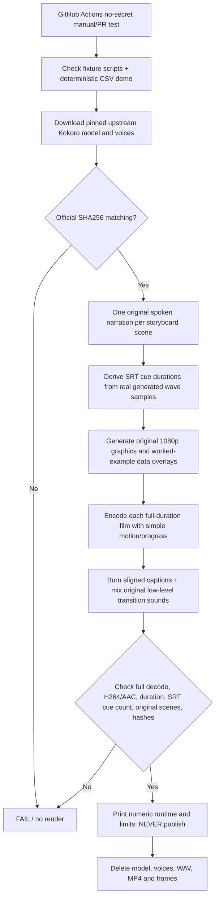

# ADR-0009 — Real cloud full-duration teaching-pack benchmark (no publishing)
**Date:** 2026-11-04 · **Track:** Branch 2 / Cloud Autopilot · **State:** implementation experiment, not verified production.

## Why this is the next gate
PR #11 proved three four-second Kokoro/FFmpeg diagnostics on a GitHub-hosted Ubuntu runner, but not a complete new video, captions, motion tied to worked examples, actual speech runtime for long text, audio mixing, full decode or daily throughput. The previous full-pack Remotion workflow uses media from older already-produced videos and therefore cannot establish fresh daily narration capacity.

**Decision:** Build an independently runnable 2 Shorts + 1 long production-length **sample pack** entirely on GitHub Actions, using only synthetic, openly reproducible CSV data and new original scripts. It must produce full spoken audio, synchronized SRT cues and burning subtitles, evolving worked-example graphics, original transition audio, and exact H.264/AAC deliverables at 1080×1920 (Shorts) and 1920×1080 (long). It must inspect all files with ffprobe, full FFmpeg decode and actual audio/caption scene timing, report timings/bytes/checksums, and delete all generated assets afterward. No YouTube write, no export of media outside the ephemeral runner.

## Editorial demonstration — no current-news claims
A synthetic four-row membership CSV is generated as a programmatic tutorial fixture:
```csv
member_id,joined_on,status
00127,2026-11-01,active
00128,2026-11-02,paused
00127,2026-11-03,active
00129,11/04/26,active
```
The scripts explain demonstrable Python standard-library behavior and why avoiding automatic integer conversion matters for ID labels; the first Short illustrates leading zeros, the second independently illustrates duplicate-ID conflicts and review, while the long teaches a full inspect-preserve-validate-report workflow including ISO date parsing. A **real `csv.DictReader` + `datetime.date.fromisoformat` computation** drives the visuals and is asserted by tests. Documentation: https://docs.python.org/3/library/csv.html and https://docs.python.org/3/library/datetime.html .

The text is fixture-written, **not** a claim that an unconnected LLM wrote it, that all statements have independent expert review, or that it has been judged ready for public release. This is *prototype educational narration*, not the 48-role production content pipeline.

## Pipeline and gates


### Non-negotiable constraints
- **Privacy:** no laptop, Nirala, local user files, cloud OAuth, sensitive channel data, real third-party media, paid providers, GitHub artifacts containing video, or copying results into public Git history.
- **Rights:** program-generated graphics, original text, authored synthetic dataset, upstream pinned public model and license documentation only. This does not substitute for actual human review of voice performance, fact claims or copyright before YouTube publishing.
- **Accuracy:** all visuals derived from actual Python calculations; captions timed from measured speech audio, not estimates; real QA checks full audio/video duration, codec, pixel format, distinct spoken lines and no gaps beyond expected pauses.
- **Quality:** dynamic demonstrations and separate topics matter, but template graphics alone are insufficient for a real YouTube release. Real B3 acceptance requires distinct scripted demos, visual quality review, rights/factual proof, actual viewer value and tested creative variation.
- **Runtime:** a green four-second smoke cannot justify any forecast for 3/day. Run the **full scripts** and measure real runner duration, memory, media sizes and wall time first. GitHub Actions schedule is not a guaranteed exact delivery clock (https://docs.github.com/en/actions/reference/workflows-and-actions/events-that-trigger-workflows).
- **No production writing:** never connect B3 benchmark to OAuth/D1/storage/publishing workflow. Publishing stays disabled, even when every technical check passes.
- **Separation:** Keep assisted releases in Branch 1 untouched; test Branch 2 solely through public GitHub repo and cloud runner.

## Acceptance for *this benchmark*, not for publishing
1. Two complete Short-like original tests between **25 and 59 seconds** and one substantive long-like test between **95 and 240 seconds** with audio, captions and distinct original demonstration scenes.
2. Three real separately synthesized Kokoro voices; all upstream bytes verified against the **tagged GitHub release**; no borrowed music/assets.
3. FFprobe H.264/AAC at 1080×1920 or 1920×1080, yuv420p, full FFmpeg error-on-decode pass; exactly one video and one audio stream. Rendered captions visibly burned, plus measured matching SRT scene timing; hashes and sizes recorded.
4. Real runtime and resource receipts in GitHub Actions job summary, with cleanup even after failure; no artifact storage.
5. Tests reject wrong sample data, missing narration, insufficient scenes, invalid caption timings, bad hashes, or any attempted release authority.
6. Explicit outcome: `FULL_DURATION_EDUCATIONAL_TECHNICAL_BENCHMARK_NOT_PUBLISHABLE`.

## Following gates
After a passing full-duration pack, integrate independently source-backed model-generated creative script, genuine education assets and systematic motion/sound QA with signed human review; then private cloud storage/ledger/OAuth under new owner approval; then seven days/21 *verified* public releases with every user's laptop offline. GitHub-only success does not create the owner permissions or free-tier budget.
